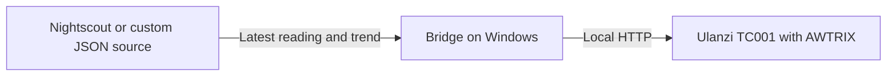

# Ulanzi Glucose Bridge

[Português (Brasil)](README.pt-BR.md) · [Report an issue](https://github.com/Ptraskus/ulanzi-glucose-bridge/issues) · [Releases](https://github.com/Ptraskus/ulanzi-glucose-bridge/releases)

Ulanzi Glucose Bridge is a Windows app that displays your Nightscout glucose reading and trend on an Ulanzi TC001 running AWTRIX. It reads your existing Nightscout site and sends updates to the clock over your local network.


## Features

- **Large digits and a trend arrow.** On AWTRIX NG, digits use all eight rows of the display. AWTRIX 3 is also supported, using text and trend symbols.
- **Configurable range colors.** Readings change color according to your thresholds. Missing or stale readings show **NO DATA**.
- **Windows setup wizard and dashboard.** Connect Nightscout, find the clock, test connections and check the latest reading. English and Brazilian Portuguese are available, with readings in **mg/dL** or **mmol/L**.
- **Optional sound alerts and floating display.** Configure alerts on the clock or keep the reading visible in a small desktop window.

**The computer must stay on, awake and connected, with the app running, for readings to keep reaching the clock.** Closing the dashboard leaves the app running in the Windows notification area.

**Windows 10 1809+ / Windows 11 · Node.js 22+ · [MIT license](LICENSE)**

Install from the source ZIP using the [Windows setup steps](#step-by-step-on-windows). See [Troubleshooting](#troubleshooting) if you get stuck.

> This is a supplementary display, not a medical device. Keep using your official apps and alarms; do not use the clock as your only basis for treatment decisions. Initial thresholds are software defaults, not clinical recommendations.

## Before you begin

**Nightscout** supplies the readings, this app sends them to the clock, and **AWTRIX** is the firmware that displays them. The bridge does not connect directly to your sensor.

| What you need | In plain language |
| --- | --- |
| A Windows computer | Windows 10 version 1809 or newer, or Windows 11, with Windows PowerShell 5.1 and WinForms. The desktop app is Windows-only; packaged runtimes target x64. |
| Node.js 22 or newer | The software that runs the bridge. Install it once, as explained below. |
| An Ulanzi TC001 with AWTRIX | Use AWTRIX NG for the large-digit layout, or AWTRIX 3 for text mode. The original Ulanzi software is not supported. The wizard includes guidance if you still need to prepare the clock. |
| A Nightscout site already showing current readings | Open your site in the browser and check that readings are arriving. Have its address and access token or `API_SECRET` ready if required. An authorized JSON source is also supported. |
| A shared local network | The computer and clock need to communicate, usually through the same home router. Guest Wi-Fi can block this even when both devices have internet access. |

If you do not have a working Nightscout site yet, start with the [Nightscout setup guide](GUIA-NIGHTSCOUT.md). Installing this bridge does not create a Nightscout server or configure the connection between your sensor and Nightscout.

## Step by step on Windows

You do not need to program, install Git, type terminal commands or run `npm install`.

### 1. Install the software that runs the app

Open the [official Node.js download page](https://nodejs.org/en/download), download the **Windows installer for Node.js LTS, version 22 or newer**, and run it. Keep the default options, including the option to add Node.js to PATH. You only need to do this once; skip it if a suitable version is already installed.

### 2. Download and extract the app

1. Open [this repository on GitHub](https://github.com/Ptraskus/ulanzi-glucose-bridge).
2. Click **Code**, then **Download ZIP**.
3. Find the downloaded ZIP, right-click it and choose **Extract All**.
4. Extract it to a folder you can keep, such as **Documents**. Open the extracted folder containing `Start.cmd`.

Do not run the app from inside the ZIP or place it in `Program Files`: it needs the extracted files and permission to save its settings.

### 3. Open the app

Double-click **`Start.cmd`**. If Windows hides file extensions, it may appear simply as **Start**. The launcher checks Node.js and opens the dashboard. Select **Set up now**.

If Windows blocks a downloaded script, verify that it came from this repository and review the warning. Do not disable system protection globally. Managed work or school computers may require assistance from their administrator.

### 4. Follow the setup wizard

Use **Next** to move through the screens. The table below follows their order; button names assume you selected English.

| Step | What to do |
| --- | --- |
| Language | Choose **English** or **Português (Brasil)**. |
| Prepare the clock | If AWTRIX is installed and connected to Wi-Fi, select that option and confirm completion. Otherwise, follow the preparation guidance and the [official AWTRIX NG flasher](https://blueforcer.github.io/awtrix-ng/getting-started/flashing/). Installing AWTRIX replaces the clock's software and settings: back up first and use a USB data cable. The bridge does not install firmware automatically. |
| Choose the source | Select **Nightscout (recommended)** to use your existing Nightscout readings. |
| Connect Nightscout | Enter the main HTTPS address you open in your browser, such as `https://my-nightscout.example`. This is an example: use your own address, without `/api/v1/...` or credentials. Choose the appropriate access method and paste the token into its separate field, or choose `API_SECRET` and enter the original secret. Use public access only if your site allows it. |
| Test the source | Click **Test Nightscout** and wait for confirmation that it connected and found a reading before continuing. Check the reading's time on your Nightscout site too: connecting successfully does not guarantee fresh data. |
| Find the clock | Click **Search**. If it does not find the TC001, enter the IP address shown by AWTRIX, for example `http://192.168.1.50`. **That address is only an example; use your own clock's IP.** Enter its HTTP username and password only if you enabled that protection. |
| Test the clock | Click **Test TC001** and wait for confirmation before continuing. |
| Choose preferences | Choose **mg/dL** or **mmol/L** and review the display ranges. **Automatic sound alerts start off.** Sensor-expiry estimation is optional and also starts off; leave it disabled unless you have a reliable sensor-start event and know your model's duration. |
| Review and finish | Check the summary, then click **Save and activate**. The bridge can now start sending readings to the clock. |

### 5. Check the result

With a current reading and both connections working, the clock should show **your glucose value and trend arrow**. Compare the value and reading time with Nightscout, and check source and clock status on the dashboard. **NO DATA** means a reading is unavailable or too old; see [Troubleshooting](#troubleshooting).

A successful connection test checks communication. Look at the actual clock to confirm the display, and test its sound separately if you enable alerts.

## Everyday use

Open **`Start.cmd`** whenever you want to run the app. It stays in the Windows notification area, near the system clock; closing the panel does not quit it. Reopen the panel from that icon, or choose **Exit** from its menu to stop the app.

Keep the computer awake and connected to the source and TC001. Use the dashboard to check the latest reading, its age and connection status. You can change display settings and optional alerts later, without repeating the entire initial setup.

After a power or network outage, leave the app running: it keeps retrying. For AWTRIX NG, configure the clock's actual `http://<hostname>.local` address so a changed DHCP address does not require setup again. If local name resolution fails, the bridge uses AWTRIX discovery on the local network and accepts only the matching hostname and port, then checks the device identity. It rebuilds the reading and its expiry before sending. An IP address entered directly still needs a router reservation to remain stable. Automatic discovery requires local UDP communication; it does not bypass guest-network isolation or a firewall. Windows automatic startup, when enabled, begins after you sign in.

`Configure.cmd` opens the setup wizard directly. The original Portuguese commands, `configurar.cmd` and `iniciar.cmd`, remain available for compatibility. `iniciar.cmd` runs the bridge in a visible console; it does not open the dashboard.

## CGM compatibility

Compatibility depends on the data reaching Nightscout. The bridge reads the glucose value, timestamp and trend from its standard API, regardless of sensor brand. Your sensor's uploader or integration must already be sending current, valid readings to Nightscout; individual sensor and uploader combinations have not all been tested with this bridge.

See the [Nightscout connection guide](GUIA-NIGHTSCOUT.md) and Nightscout's [uploader documentation](https://nightscout.github.io/uploader/setup/) for setup. For custom integrations, the app also accepts a [JSON endpoint](#sources-and-reading-states).

## How it works



The app validates the reading timestamp, checks its age, determines the display and optional alerts, and sends the result to the clock. Display commands expire so an old reading is not intended to remain indefinitely when delivery stops.

## Setup and everyday settings

The dashboard groups settings into the areas below. Enter credentials only in the local wizard.

| Area | What you can do |
| --- | --- |
| Home | Check the latest reading and the app, source, clock and sound status. |
| Alerts | Enable alarms and set thresholds, repeat intervals and sound patterns. |
| Display and sensor | Choose language and glucose unit, display options, refresh interval, sensor duration and floating display. |
| Connections | Check source and device connectivity, open Nightscout and rerun setup. |
| Support | Run diagnostics, export a sanitized report, restore configuration and restart. |

Use **Save and apply** to validate and persist changes. The app keeps the three most recent valid configurations for recovery. To change credentials or source addresses, rerun setup from Connections.

### Language and glucose units

English is the default for new installations. Select **English** or **Português (Brasil)** during setup, or use the **Language / Idioma** button at the bottom of the dashboard to open display settings. Existing explicit language preferences are preserved.

Choose **mg/dL** or **mmol/L** independently of the language. The display uses whole numbers for mg/dL and one decimal place for mmol/L. **Visual and alarm thresholds in settings remain explicitly labeled in mg/dL**, regardless of the reading unit. Changing units does not convert or round your saved thresholds. Internally, readings and environment variables ending in `_MGDL` use mg/dL. The JSON source always expects `valueMgDl`, even when displaying mmol/L. Switching the display unit does not change the source data.

### Initial behavior

| Setting | Default |
| --- | --- |
| Language | English (`APP_LANGUAGE=en`) |
| Display unit | mg/dL (`DISPLAY_UNITS=mgdl`); mmol/L is available. |
| Poll interval | 60 seconds. |
| Maximum reading age | 15 minutes. |
| Visual range | 70–180 mg/dL; configurable and independent from alarm thresholds. |
| Automatic sound alarms | Off. |
| Windows fallback notifications | Off. |
| Sensor-expiry estimate | Off (`SENSOR_LIFETIME_DAYS=0`). An optional model-specific duration supports fractional days, up to 365 days. |

The complete configuration reference is [.env.example](.env.example). For normal use, prefer the wizard, which saves credentials in the Windows-protected vault. Do not copy the example over an existing `.env`.

## Sources and reading states

| Source | Purpose | Authentication |
| --- | --- | --- |
| `nightscout` | Latest reading from your Nightscout instance. | Read access token or `API_SECRET`; the API secret is hashed before use in the header. |
| `json` | Authorized endpoint with the response format below. | Optional token. |
| `mock` | Simulated reading for testing. | None. |

Use the final HTTPS source URL without credentials in the URL. Plain HTTP sources are allowed only on the local computer (loopback). Source requests do not follow redirects, to avoid forwarding authentication to another destination. The TC001 uses local HTTP; see [AWTRIX network security](GUIA-SEGURANCA-AWTRIX.md).

Example JSON response with fictitious data:

```json
{
  "valueMgDl": 112,
  "trend": "flat",
  "timestamp": "2026-01-01T12:00:00Z"
}
```

Use the actual reading time; this example's timestamp will be stale if copied unchanged. Accepted trends: `double-up`, `up`, `up-slight`, `flat`, `down-slight`, `down`, `double-down`, `unknown`.

An unavailable or stale reading shows **NO DATA** (**SEM DADO** in Portuguese). If sensor-expiry estimation is enabled, a recorded Nightscout `Sensor Start` or `Sensor Change` event and your configured duration can produce a **CHANGE** (**TROCAR**) status. This is an estimate, not a sensor-reported end-of-life status. Without the event the app cannot infer expiry; ordinary glucose display still works. When the estimate is disabled, the bridge does not query sensor events. A still-valid low or high reading retains priority until it becomes stale. The sensor-change state does not trigger the no-data sound.

Automatic alerts are optional. Their visual thresholds and audible thresholds are independent. Sound profiles change beep patterns and repetition, not calibrated loudness. Hysteresis and rearming delays reduce repeated alerts near thresholds. The `double-down` arrow is displayed but currently has no dedicated sound rule. Test the clock's actual behavior before relying on notifications.

## Privacy and updates

There is no project telemetry, advertising, app account or project server. Glucose processing happens locally; the configured data service and firmware have their own behavior and privacy policies.

| Local path | Contents |
| --- | --- |
| `.env` | Service addresses and preferences. Do not share it. |
| `.secrets/` | Credentials protected with Windows DPAPI for the current Windows user. |
| `.runtime/` | Operational state and rotating logs. |
| `.config-history/` | Local recovery copies. |
| `.updates/` | Installers explicitly downloaded for updates. |

New UI preferences are stored under `%LOCALAPPDATA%\Ulanzi Glucose Bridge`. Upgrades can reuse the previous preference and installation folders to preserve existing data. These paths are excluded from source publication and release packages. A normal uninstall preserves user data. Credentials must be entered again when moving to another Windows account or computer.

Review diagnostic exports before sharing them, even though they remove readings and redact sensitive fields. Never attach `.env`, vault files, logs or screenshots containing private information to a public issue.

The updater stays disabled until a maintainer configures a release channel and expected publisher. When enabled, it checks HTTPS, SHA-256 and Authenticode before allowing installer execution. Publishing source code on GitHub does not activate automatic updates.

See [Privacy](PRIVACY.md), [Security](SECURITY.md), and the [private vulnerability report form](https://github.com/Ptraskus/ulanzi-glucose-bridge/security/advisories/new).

### Upgrading from the previous name

Version 0.3.0 renames the project from Ulanzi Libre Bridge to **Ulanzi Glucose Bridge**. Existing configuration, encrypted credentials, history and explicit sensor durations remain compatible. The old `LIBRE_SENSOR_LIFETIME_DAYS` setting is accepted as a fallback; `SENSOR_LIFETIME_DAYS` takes precedence when set. New configurations use the generic key and start with expiry estimation disabled. Changed duration settings use the generic key; saving without changes preserves the existing document.

Existing Windows installation and preference folders may retain their old names. Do not delete them to complete the rename. Stable internal Windows identifiers are deliberately retained for upgrade and single-instance compatibility. Exit the running copy before upgrading or opening the app from another folder.

## Troubleshooting

| Problem | Next step |
| --- | --- |
| Start says Node.js is missing or too old | Install Node.js LTS 22+ from the official site, then reopen Start. Extract every file if using a bundled-runtime ZIP. |
| Setup is required | Select Set up now. The bridge stays stopped until configuration is valid. |
| Start does not open another copy | Only one copy runs per Windows user. Use the existing tray icon; select Exit before launching from a different extracted or installed folder. |
| Clock does not respond | Confirm compatible AWTRIX firmware, address, credentials, firewall and local network access; repeat the wizard's clock test. |
| NO DATA | Check the source's timestamp, connectivity and maximum reading age. A successful connection does not guarantee a fresh reading. |
| No sound | Check the automatic-alert switch, clock buzzer and physical sound test in Support. |
| Unit or language is unexpected | Check Display and sensor. Language and glucose unit are independent preferences. |
| Credentials fail after moving the folder | Rerun setup under the target Windows account; a DPAPI vault cannot be copied as portable passwords. |
| Updates unavailable | A signed release channel is not configured; check GitHub for source changes. |

## Development and validation

<details>
<summary>Try the terminal demonstration without an account or clock</summary>

Open PowerShell in the extracted folder and run:

```powershell
npm.cmd run demo
```

This simulates **112 mg/dL**, prints the display payload and exits without contacting a real source or sending anything to a clock. It does not create configuration or credentials. It is a terminal demonstration; the full graphical setup still requires a TC001 for its device checks. Existing `.env` preferences can affect formatting, but the demo always uses the mock source with device delivery disabled.

</details>

<details>
<summary>Future installer and portable packages</summary>

When a release includes a signed `Ulanzi-Glucose-Bridge-Setup-<version>.exe`, verify its publisher and the release checksums, then run it. It installs for the current user, offers English or Portuguese, and can create a desktop shortcut and start with Windows. A package marked `portable-node` includes Node.js and needs no separate runtime installation; extract it completely and open `Start.cmd`.

The GitHub **Source code (zip)** download does **not** include Node.js. Do not confuse it with a `portable-node` release asset. See [release and signing instructions](PUBLICACAO.md) for maintainers.

The bundled runtime contains Node.js and its license, without npm. To run the terminal demo from that package without installing Node globally:

```powershell
.\runtime\node\node.exe .\src\index.mjs --source=mock --once --dry-run
```

</details>

```powershell
# Optional alternative to Download ZIP
git clone https://github.com/Ptraskus/ulanzi-glucose-bridge.git
cd ulanzi-glucose-bridge

# Syntax, tests and a no-network demo
npm.cmd run check
npm.cmd test
npm.cmd run demo

# Check launcher prerequisites without opening the app
powershell.exe -NoProfile -ExecutionPolicy Bypass -File .\scripts\launch-app.ps1 -Check

# Read the configured source without delivering to the clock
.\iniciar.cmd --once --dry-run

# Text-based setup for support
.\Configure.cmd -Console
```

The automated suite includes Windows PowerShell/WinForms checks; run the full suite on Windows. It cannot substitute for physical clock testing or clean-machine installation validation. Maintainer packaging, signing and release checks are in [PUBLICACAO.md](PUBLICACAO.md).

Source is in `src/`, Windows UI and tooling in `scripts/`, translations in `locales/`, installer definitions in `installer/`, and automated checks in `test/`. Keep personal configurations and credentials out of commits and pull requests. This is an independent community project, not affiliated with CGM manufacturers, Ulanzi, AWTRIX or Nightscout.
